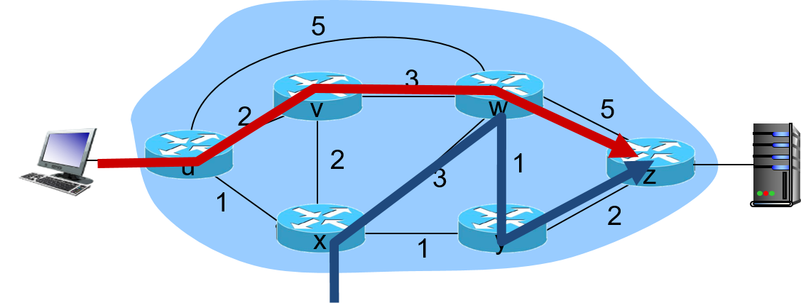

# Wiederholungsfragen K4 — Software-defined Networking

*Zu Kapitel 4 (`4-AdvCompNet-SDN.md`, L6/L7) · Literatur: SDN-Buch Ch. 1, 3, 6; 7E §4.1, §10*

*Übernommen aus „Wiederholungsfragen 3: Software-defined Networking" (WiSe 25/26); OpenFlow-Detailfragen gestrafft, B4/Jupiter und Telemetrie neu (L7).*

## Grundlagen

1. Was ist Network Softwarization? Welche Ausprägungen gibt es und was ist deren Basis?
2. Welche drei abstrakten Planes existieren in klassischen Netzstrukturen? Worin liegen deren konzeptuelle Unterschiede bzw. was sind deren individuelle Aufgaben?
3. Skizzieren und beschreiben Sie eine grundlegende SDN-Architektur. Welche Funktionskomponenten existieren und welche Aufgaben übernehmen diese?
4. Was verstehen Sie unter *generalized forwarding* im Kontext von SDN? Welche Rolle spielt hierbei beispielsweise OpenFlow?

## Traffic Engineering und OpenFlow

5. Erläutern Sie den Einsatz von SDN für das Traffic Engineering anhand der folgenden Abbildung (Kurose/Ross): Wie entscheidet der Controller um, welchen Weg welcher Traffic nimmt?

    

6. Wie kann die Herausforderung sich wandelnder Traffic Pattern im Data Center durch SDN exemplarisch adressiert werden?
7. Was verstehen Sie unter Pipelining/Pipeline Processing im Kontext von OpenFlow? Welche Vorteile ergeben sich hierdurch?
8. Welche grundlegende Struktur weisen OpenFlow-Flow-Tables bzw. deren Entries auf? *(Kernidee Match/Action — die OpenFlow-Details wurden in der Vorlesung bewusst gestrafft: „was davon geblieben ist")*
9. Handelt es sich bei SDN (z. B. mit OpenFlow) um einen „clean slate"- oder „evolutionary"-Ansatz? Begründen Sie Ihre Antwort.

## Control Plane und Betrieb

10. Warum muss bei der Bereitstellung eines OpenFlow-/SDN-Controllers dessen Ausfallsicherheit berücksichtigt werden? Wie kann diese realisiert werden?
11. Wie kann eine Lastverteilung für mehrere OpenFlow-/SDN-Controller realisiert werden? Welche Herausforderungen stellen sich hierbei?
12. Google: Erläutern Sie die Evolution von B4 (WAN) über Jupiter (Data Center) zu Orion — was blieb vom SDN-Konzept, was änderte sich? *(neu, L7)*
13. Welche Rolle spielt Telemetrie im Betrieb software-definierter Netze (Metrics, Logs, Traces)? Was ist „Feature Velocity"? *(neu, L7)*
14. „OpenFlow hat sich als Protokoll nicht durchgesetzt, SDN als Idee schon." Wie bewerten Sie diese These?
15. Welche Entwicklungen erwarten Sie für SDN und wie bewerten Sie diese?
